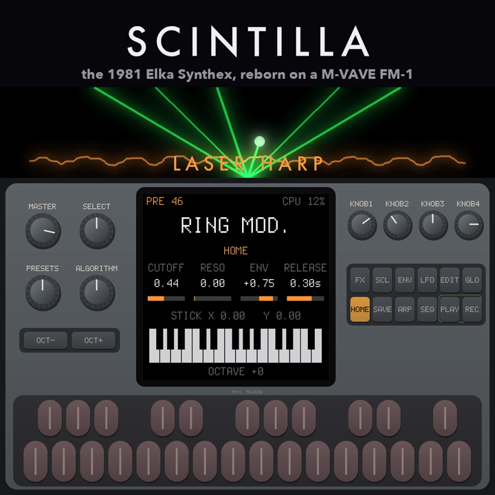

# Scintilla

<p align="center"></p>

**The 1981 Elka Synthex, reborn on the M-VAVE FM-1.** Scintilla is the Elka Synthex of [synthex-web](https://github.com/joakimeriksson/ai-smarthome/tree/master/audio/software-synth/synthex)
as an engine for the **M-VAVE FM-1** pocket synth: fixed-point C for its JieLi AC791N (pi32v2, no FPU, two
240 MHz cores), checked sample by sample against the browser original and measured on the emulated FM-1
([fm1-emu](https://github.com/joakimeriksson/fm1-emu)).

**Status: 0.1.1, runs on the FM-1.** The engine plays all 80 factory patches (the 40 PRESETS and 40 MEMORIES,
Paul Wiffen's Laser Harp "Ring mod." among them) on this computer and on the emulated FM-1, with the same bits on
both. [`firmware/`](firmware) makes it a firmware of its own on Dinghy: the keys, the knobs and pages, the screen,
USB and DIN MIDI, USB audio, velocity and aftertouch from the FM-1's own keys (on its SETTINGS page), installable as `scintilla.fwsc`. Installed and played on a real FM-1 (2026-10-23); every check in the tests runs in
fm1-emu.
The delay is not there yet (see [PLAN.md](PLAN.md)); the reverb is an algorithmic one measured against the app's.

**Get it:** [Install on my FM-1](https://joakimeriksson.github.io/scintilla-fm1/) on its page (over USB, in Chrome or
Edge), or the `.fwsc` from the [latest release](https://github.com/joakimeriksson/scintilla-fm1/releases/latest), installed with the
[FM-1 Firmware Hub](https://thefirmwarehub.com) or `firmware/tools/fm1_install.py scintilla-0.1.1.fwsc` (USB-MIDI).
Hold **OCT-** while switching on for the USB rescue; the hub takes it back to the official firmware. The release
also has a short video of it playing. Scintilla does not read other firmwares' projects or samples: its own 80
sounds are built in, and it keeps only its settings. It reports the identity `FM-1_963XYYZZ` (0.1.1: `FM-1_96300101`).

## What is in it

| | |
| --- | --- |
| `engine/` | the synth, integer C with no dependencies: `sc_voice.c` (one voice: two PolyBLEP oscillators, noise, the zero-delay-feedback filter in five modes, two envelopes, two LFOs, glide, sync, ring and cross mod), `sc_synth.c` (two layers, poly / mono / unison, split / double, chorus, reverb, limiter) |
| `engine/sc_presets.h` | the factory bank, generated from synthex-web's `factory.ts` by `tools/gen_presets.mjs` |
| `engine/sc_tables.h` | pitch, cutoff, sine, log2 / exp2 tables for 44.1 kHz (`tools/gen_tables.py`) |
| `host/sc_render.c` | renders a scenario on this computer: one voice as float32, or the instrument as a WAV |
| `tools/ref_render.mjs` | the same scenario through synthex-web's own `VoiceCore`: the reference |
| `tests/run.sh` | every preset through every scenario in both, scored (`tools/score_all.py`) |
| `firmware/` | **the firmware**: Scintilla on Dinghy 0.3 (`firmware/src/scintilla.c`), `./build.sh` -> `build/scintilla.fwsc`, `tests/emu_test.py` on the emulated FM-1. [Its README](firmware/README.md) |
| `fm1/` | the engine as a bare-metal program for the FM-1's CPU: `run.py` counts its instructions in fm1-emu and checks its output against the host build; `listen.py` has it play a song into a WAV, checked sample for sample |

## How close it is

`tests/run.sh` renders each of the 80 patches through four scenarios (a held note, a phrase, the joystick, chords)
in VoiceCore and in the C engine: **level within 0.21 dB everywhere (median 0.001 dB), spectrum within 0.03 dB
(median)**. The few with larger spectral differences are within the reference's own floor: VoiceCore seeds one noise
oscillator at random, and hard sync turns a 0.00005-semitone pitch difference into a different waveform, so the test
renders the reference twice (the second nudged by that much) and holds the C engine to that floor.

## What it costs on the FM-1

`fm1/run.py`, instructions per 256-frame block (the 5.8 ms the audio interrupt has), one 240 MHz core, the
FM-1's output bit-identical to the host's:

| patch | voices | % of a core |
| --- | ---: | ---: |
| Chunky Synth (2 saws, 24 dB) | 8 | 20 % |
| Chunky Synth, both layers | 16 | 38 % |
| Brushed Cymbals (noise) | 8 | 20 % |
| Sync. Harmonic Sweep | 8 | 34 % |
| Ring mod. (the Laser Harp: sync, ring, cross mod, PWM, glide) | 8 | 49 % |

Instructions are a lower bound on cycles (flash loads and divides take longer). FM-1 firmwares aim to stay under half
of a core.

## Running it

```sh
python3 tools/gen_tables.py                                       # engine/sc_tables.h
node --experimental-transform-types tools/gen_presets.mjs         # engine/sc_presets.h (SYNTHEX_WEB=path to synthex-web)
tests/run.sh                                                      # the comparison with VoiceCore
fm1/run.py                                                        # the cost on the emulated FM-1
fm1/listen.py                                                     # a preset tour played by the emulated FM-1 -> build/listen/fm1-emu.wav
fm1/listen.py out.wav --part 36:tests/scenarios/chords.txt         # any preset:scenario parts
cc -O2 -o build/sc_render host/sc_render.c engine/sc_voice.c engine/sc_synth.c -lm
build/sc_render list                                              # the presets
build/sc_render synth 36 tests/scenarios/chords.txt laser.wav     # listen
```

`fm1/build.sh` needs the JieLi toolchain (`~/.jieli/toolchain`, as fm1-harbor) and, on macOS, Docker; `fm1/run.py`
and `fm1/listen.py` need fm1-emu built from its master of 2026-10-19 or later.

## Licence

GPL-3.0-only (`LICENSE`), as the FM-1 firmware platforms it will join. The engine is a port of synthex-web
(BSD-2-Clause, Joakim Eriksson). `fm1/crt0.S` and `fm1/bench.ld` come from fm1-emu's fm1-sid (BSD-2-Clause).
"Elka" and "Synthex" are names of their owners; "M-VAVE" and "FM-1" belong to theirs. Scintilla is not affiliated
with or endorsed by Elka, Generalmusic, Behringer / Music Tribe or M-VAVE.
