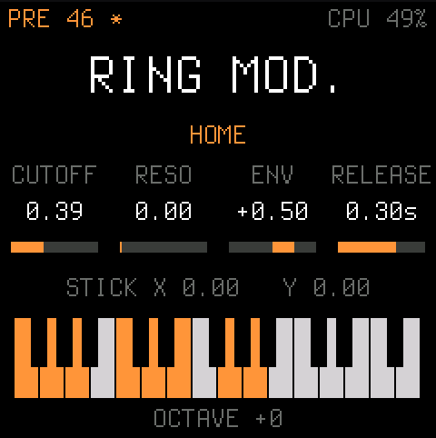

# Scintilla: the firmware

**The Elka Synthex on the M-VAVE FM-1**: the engine of [synthex-web](https://github.com/joakimeriksson/ai-smarthome/tree/master/audio/software-synth/synthex)
(its VoiceCore and instrument), ported to integers in [`../engine`](../engine) and checked against the original
there, as a firmware of its own on [Dinghy](https://github.com/zvenson/dinghy) 0.3.

<p align="center"></p>

> **Status: 0.1, runs on the FM-1.** Installed and played on a real FM-1 (2026-10-23). Every check below is in
> [fm1-emu](https://github.com/joakimeriksson/fm1-emu) (`tests/emu_test.py`).

## Playing it

| | |
| --- | --- |
| **Keys** | play: two layers of 8 voices each, as the patch says (single, split, double), poly / mono / unison |
| **PRESETS** | the 80 factory sounds: PRE 10..49 and MEM 10..49, the Synthex's addresses |
| **KNOB1..4** | the four parameters on the screen. A change applies to both layers, each from its own value |
| **HOME** | cutoff, resonance, filter envelope amount, amp release |
| **EDIT** | OSC 1, OSC 2, MIX (press again for the next page) |
| **ENV** | FILTER, FILTER ENV, AMP ENV |
| **LFO** | LFO 1 (rate, shape, to pitch, to cutoff), LFO 2 (rate, shape, the joystick's two LFO 2 depths) |
| **GLO** | glide mode, amount, speed; poly / mono / unison |
| **FX** | chorus (off, 1, 2, 3), volume, unison detune, tune; press again: reverb (off, plate, room, hall, galactic), size, damping, mix |
| **SEL** (`SCL` on the panel) | the joystick page: X, Y and the two BEND depths; SEL again centres the stick |
| **SELECT** | the joystick up and down: pitch bend (and the filter, by the BEND depths) |
| **ALGORITHM** | the joystick left and right: LFO 2 into the pitch (left) or the filter (right) |
| **OCT- OCT+** | the octave |
| **MIDI in** | USB and the DIN jack, any channel: notes with velocity, pitch bend (2 semitones), CC1 = the stick pushed left (vibrato, as on the Synthex), CC74 the cutoff, CC91 the reverb's mix and CC93 the chorus's (0 turns it off), program change, CC120 / 123 |

The preset, the octave and the page are kept in flash. Edits to a sound are not kept (yet): the `*` after the
address says the sound differs from the preset. The top right shows the CPU: the slowest render of the last second,
as a part of the 5.8 ms the audio interrupt has.

Not there yet (see [`../PLAN.md`](../PLAN.md)): delay (the factory sounds play without it), saving
your own sounds, the arpeggiator and sequencer.

## Build, run, test

```sh
./build.sh                         # -> build/scintilla.fwsc (fails on what would brick the FM-1)
tests/emu_test.py                  # on the emulated FM-1: the sound, the engine, presets, knobs, MIDI, the CPU
tests/emu.py --keys "1000:21,1000:25,1000:28" --ms 3000    # any script -> build/emu/run/audio.wav, panel.png
tests/run_host.sh                  # scintilla.c on this computer: build/host/scintilla.wav, screens
```

`build.sh` needs the JieLi toolchain, the JieLi AC79 SDK and Pillow, as [Dinghy's README](https://github.com/zvenson/dinghy#2-set-up-once)
says (on macOS it runs the toolchain in Docker). The tests need fm1-emu built (`cargo build --release` in
`~/work/fm1-emu`, or `FM1_LIVE`).

What `tests/emu_test.py` checks, on fm1-emu's emulated FM-1 (fm1-live, headless):

- every instruction of the build is one the emulator knows (`fm1-emu --check-decode`);
- it boots silent, and a key plays;
- **the note is the engine's**: the FM-1's output equals the engine rendered on this computer
  (`tests/engine_ref.c`) to the MASTER knob's rounding (-60 dB), once the reference has run as many blocks as the
  firmware had before the note (the chorus runs freely);
- PRESETS loads the right sound, KNOB1 moves the cutoff by its steps;
- eight voices of Ring mod., the heaviest factory sound, by the firmware's own meter (49 % of a block);
- MIDI into the DIN jack: a program change and a note.

## How it is made

```
firmware/src/scintilla.c    <- the app: the panel, the pages, MIDI, the screen; app_audio() runs the engine
../engine/                <- the engine (copied into build/engine by tools/build.py, compiled -O2)
firmware/src/platform.c   <- Dinghy's platform (boot, USB, updates, the audio ISR, settings), plus one hook
firmware/src/*.c, hal/    <- Felucca's platform, as SLOOP carries it
```

The audio interrupt calls `sc_render()` for 256 frames. The main loop talks to it through the engine's event queue
(`sc_post`: notes, bend, "the patch changed") and through patch fields written whole; a new preset is copied into a
staging patch and taken in by the interrupt between two blocks, so a half-written sound is never played.

Changes to Dinghy's own files: `platform.c` calls `APP_EARLY_INIT` before the key scan starts (the DIN jack's UART,
as fm1-harbor does); `gfx.c` and `tests/host.c` build host mode on macOS; `tools/build.py` copies and compiles the
engine and names the package.

**Package identity `FM-1_963XYYZZ`**, the version in the last five digits (`FM-1_96300101` is 0.1.1;
`./build.sh --release 0.1.1`). No other firmware in the [FM-1 Firmware Hub](https://thefirmwarehub.com)'s list
reports a number starting with 963 (2026-10-23); 0.1 was `FM-1_960`, which SID-1 also uses.

## License

GPL-3.0-only, as Dinghy, Felucca and SLOOP. Details, credits and third-party parts in [LICENSING.md](LICENSING.md).
Dinghy's docs are kept as they are: [docs/API.md](docs/API.md) (the platform), [docs/RULES.md](docs/RULES.md) (the
chip's rules), [docs/MAKE-IT-YOURS.md](docs/MAKE-IT-YOURS.md).
